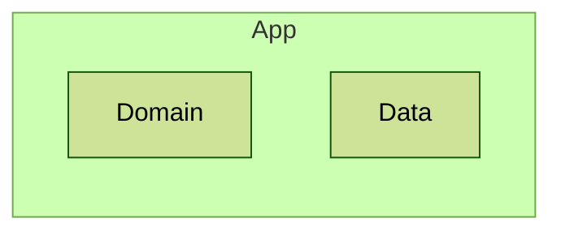

# Architecture 11

Test scenario where layers overlap. `App` layer contains every package of the project, so it also contains all
files of the nested `Domain` and `Data` layers. A file belonging to more than one layer should fail the precondition:

