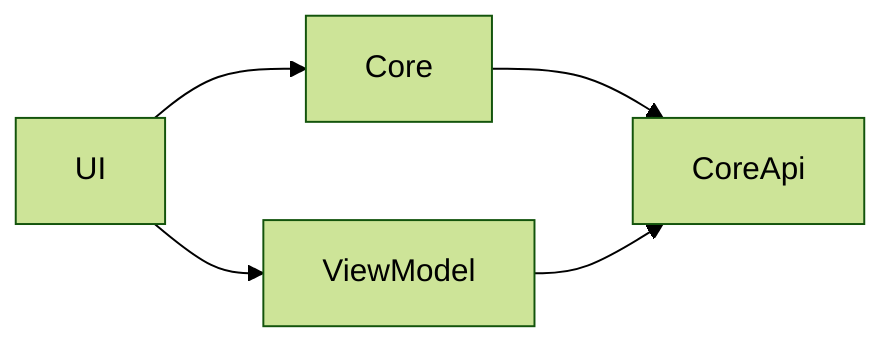

# Architecture 11

Test scenario with exact package layers (without subpackages) and layers with excluded packages:
- `Core` layer contains only the `core` package, `CoreApi` layer contains the `core.api` subpackage
- `UI` layer contains the `ui` package without the `ui.viewmodel` subpackage, `ViewModel` layer contains the `ui.viewmodel` subpackage

