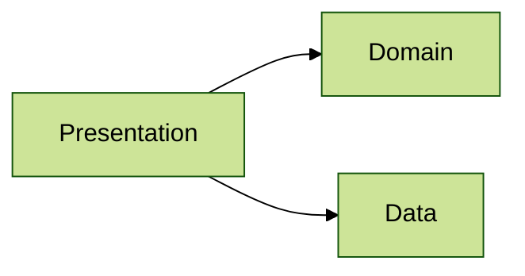

# Architecture 11

Test scenario where `Presentation` layer file depends on `Domain` and `Data` layers only through fully qualified
references (no imports). A property chain matching a layer name (`data.size`) is not a dependency:

