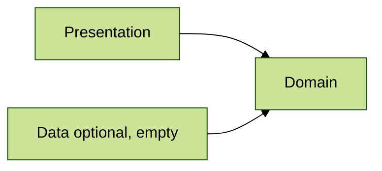

# Architecture 11

Test `optional` parameter for `Layer`.

Test scenario where `Presentation` layer depends on `Domain` one and optional `Data` layer has no files
(reuses `architecture2` project):

