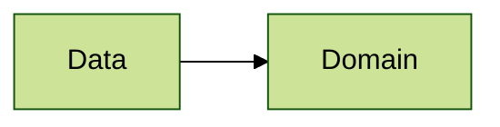

# Architecture 13

Test scenario where `Util` package and a file without a package reside outside every declared layer.
`assertArchitecture` reports these files unless `requireAllFilesInLayers = false`:

