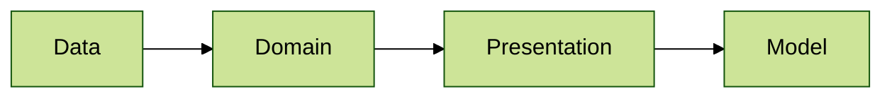

# Architecture 14

Test scenario where import names contain class names matching layer packages (`..data..`, `..domain..`).
Package of the imported declaration is matched against the layer, not the import name:

- `presentation` imports `model.Data` class - it does not reside in the `..data..` layer
- `domain` imports `presentation.Domain` class - it resides in the `..presentation..` layer, not in the `..domain..` layer
- `data` imports `domain` declarations with wildcard, nested class and top-level function imports - they reside in the
  `..domain..` layer

