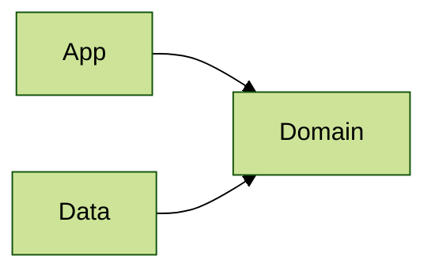

# Architecture 15

Test scenario where the `App` layer covers a single package (definition without trailing `..`). Files of the
`Domain` and `Data` subpackages do not belong to the `App` layer, so the layers do not overlap:

